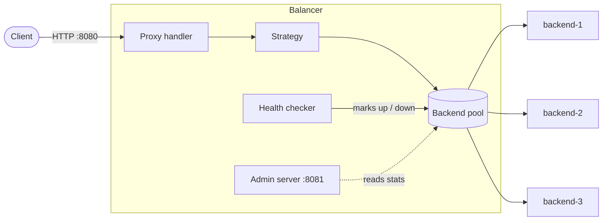

A layer-7 HTTP reverse proxy and load balancer written in Java. It distributes requests across a pool of backend servers, detecting failed backends and routes around them, retrying safe requests on different backend servers, and exposes live statistics.

It is built on the JDK's own HTTP server and client with virtual threads. There are no frameworks and the only dependencies are JUnit and Mockito, for tests. Aimed at understanding load balancers.

## Features

- **Pluggable load-balancing strategies**: round-robin and least-connections, selected by configuration
- **Active health checks**: every backend is probed on a timer, and failed backends are removed from rotation and restored when they recover
- **Passive health tracking**: failed proxied requests count towards marking a backend down, so a crash is noticed within a request or two
- **Retries**: GET, HEAD and OPTIONS requests that fail to connect are retried on a different backend, so a backend crash is usually invisible to the client
- **Live statistics**: a JSON endpoint on a separate admin port reports health, active connections, error counts and latency per backend
- **Correct proxy behaviour**: hop-by-hop headers are stripped, `X-Forwarded-For` and `X-Forwarded-Host` are set, and responses are streamed back
- **Graceful failure modes**: `503` when no backend is healthy, `502` when every attempt fails, and a clear startup error for bad configuration
- **Containerised**: Docker Compose runs the balancer and test backends with one command
- **Load-tested**: k6 scripts and simulated backends compare the strategies and Nginx (see [Load testing](#load-testing))


## Architecture



**Request Lifecycle**

1. The proxy handler reads the request and buffers the body, so it can be replayed on a retry.
2. The pool provides the currently healthy backends, minus any already tried for this request.
3. The strategy picks one.
4. The request is forwarded with hop-by-hop headers removed and forwarding headers added.
5. On success, the response is streamed back to the client. On a connection failure, the failure is reported to the health policy and, for retryable methods, the next attempt goes to a different backend.
6. If no healthy backend exists the client gets a `503`. If every attempt fails it gets a `502`.


## Quick start

**Prerequisites:** Docker with Compose. For local development you also need JDK 25.

```bash
git clone https://github.com/LMatt05/load-balancer.git
cd load-balancer
docker compose up --build
```

This starts the balancer on port `8080` and three [`traefik/whoami`](https://github.com/traefik/whoami) containers as backends. Each one replies with its own name, so you can see where requests land.

```bash
for i in 1 2 3 4 5 6; do curl -s localhost:8080 | grep Name; done
```

```
Name: backend-1
Name: backend-2
Name: backend-3
Name: backend-1
Name: backend-2
Name: backend-3
```

On Windows PowerShell, use `curl.exe` instead of `curl`, because PowerShell aliases `curl` to a different command.

### Try a failover

Keep a request loop running in one terminal:

```bash
while true; do curl -s -o /dev/null -w '%{http_code}\n' localhost:8080; sleep 0.2; done
```

In another terminal, stop a backend:

```bash
docker stop backend-2
```

Every response stays `200`. The failed attempt is retried on another backend, and after two consecutive failures backend-2 is taken out of rotation. Check its state:

```bash
curl localhost:8081/stats
```

Bring it back with `docker start backend-2`. After two successful probes (about six seconds) it rejoins the rotation.

### Switch strategy

```bash
BALANCER_STRATEGY=least-connections docker compose up --build
```

### Run without Docker

Start some backends (for example `docker compose up -d backend-1 backend-2 backend-3`, which publishes them on ports 9001 to 9003), then:

```bash
./mvnw -B package
BALANCER_BACKENDS=http://localhost:9001,http://localhost:9002,http://localhost:9003 \
  java -jar target/*.jar
```

## Configuration

All configuration is through environment variables.

| Variable | Default | Description |
|---|---|---|
| `BALANCER_BACKENDS` | *required* | Comma-separated backend URLs, for example `http://backend-1:80,http://backend-2:80` |
| `BALANCER_PORT` | `8080` | Port the proxy listens on |
| `BALANCER_ADMIN_PORT` | `8081` | Port for the stats endpoint. It must differ from `BALANCER_PORT` |
| `BALANCER_STRATEGY` | `round-robin` | `round-robin` or `least-connections` |
| `BALANCER_MAX_ATTEMPTS` | `3` | Maximum attempts per retryable request. `1` disables retries |
| `BALANCER_HEALTH_PATH` | `/` | Path probed on each backend. A response below 500 counts as healthy |
| `BALANCER_HEALTH_INTERVAL_MS` | `3000` | Time between health probes |

Invalid configuration, including malformed backend URLs and unknown strategy names, stops the balancer at startup with a clear message instead of failing later at request time.

## How it works

### Strategies

| Strategy | Behaviour | Best when |
|---|---|---|
| `round-robin` | Cycles through healthy backends in order | Backends and requests are uniform |
| `least-connections` | Picks the backend with the fewest in-flight requests, rotating among ties | Request cost varies, or backends differ in speed |

Strategies implement a small interface and know nothing about health or retries. The pool hands them only eligible backends, which keeps each strategy simple to test and makes adding a new one a single class.

### Health checking

Two mechanisms feed one policy:

- **Active:** a scheduler probes every backend in parallel on virtual threads. A response below 500 means healthy, since a 404 still proves the server is alive. A 5xx response, a refused connection or a timeout counts as a failure.
- **Passive:** when a proxied request fails to connect, the failure is reported to the same policy. This reacts faster than the probe interval.
  The policy uses consecutive-result thresholds so one blip doesn't remove a backend:

| Transition | Rule |
|---|---|
| Healthy → unhealthy | 2 consecutive failures, from probes or real requests |
| Unhealthy → healthy | 2 consecutive successful probes |

Only probes can bring a backend back, because an unhealthy backend receives no traffic.

### Retries

- Only **GET, HEAD and OPTIONS** are retried. These are safe to repeat, whereas retrying a POST could perform its side effect twice.
- Only **connection-level failures** trigger a retry: refused, reset or timed out. A backend that answers, even with a 500, has responded and the response is passed through.
- Each retry goes to a **different** healthy backend, chosen by the active strategy.
- Attempts are capped by `BALANCER_MAX_ATTEMPTS`, so an outage can't multiply load without limit.
## Admin and statistics

The admin server runs on its own port so operational data is never exposed on the public proxy port. In the Compose file it is bound to `127.0.0.1` only.

```bash
curl localhost:8081/stats
```

```json
{
  "strategy": "least-connections",
  "uptimeSeconds": 412,
  "healthyBackends": 2,
  "totalBackends": 3,
  "backends": [
    {
      "url": "http://backend-1:80",
      "healthy": true,
      "activeConnections": 3,
      "responses": 18204,
      "serverErrors": 0,
      "connectionErrors": 0,
      "avgLatencyMs": 21.43,
      "maxLatencyMs": 96.10
    }
  ]
}
```

Latency is measured from sending the request to receiving the response headers, so it reflects backend processing time and not client download speed. Counters are in memory and reset on restart. The endpoint has no authentication, so keep it off public networks.

## Project structure

```
.
├── src/main/java/com/LukeMatthews/
│   ├── Main.java                  # wiring and startup
│   ├── config/                    # environment-based configuration
│   ├── backend/                   # Backend, BackendPool, BackendStats
│   ├── strategy/                  # strategy interface and implementations
│   ├── health/                    # HealthPolicy and HealthChecker
│   ├── proxy/                     # ProxyHandler: forwarding and retries
│   └── admin/                     # StatsHandler
├── src/test/java/                 # unit and integration-style tests
├── loadtest/                      # k6 script, simulated backends, Nginx config, results
├── Dockerfile
├── docker-compose.yml             # balancer + whoami test backends
├── docker-compose.loadtest.yml    # overlay for load testing
└── .github/workflows/ci.yml       # build and test on every push and PR
```

## Testing

```bash
./mvnw -B verify
```

The suite uses JUnit 5 and Mockito. Integration-style tests start real in-process HTTP servers on random ports, so they need no Docker. They cover:

- Strategy behaviour, including even distribution under concurrent load
- Health policy transitions and recovery
- The health checker against live, failing and unreachable servers
- Proxy retries: retried GETs, un-retried POSTs, attempt limits, and 502 and 503 responses
- Statistics accuracy under concurrent updates and the JSON endpoint
  GitHub Actions runs the same command on every push to `main` and on every pull request.

## Load testing

The `loadtest/` directory holds everything needed to reproduce the benchmarks. It uses [k6](https://k6.io) in Docker, so nothing needs installing.

**Setup:** three simulated backends, two fast (20 ms per request) and one slow (100 ms), each limited to 8 concurrent requests. k6 sends a constant arrival rate of 500 requests per second for 30 seconds. Nginx runs alongside as a reference, using both round-robin and `least_conn`.

A mix of fast and slow backends is deliberate. With uniform backends the strategies perform almost identically. Least-connections only shows its value when some backends fall behind.

```bash
export COMPOSE="docker compose -f docker-compose.yml -f docker-compose.loadtest.yml"
$COMPOSE up -d --build backend-1 backend-2 backend-3 nginx
 
# Balancer with each strategy
BALANCER_STRATEGY=round-robin $COMPOSE up -d --force-recreate balancer
bash loadtest/run.sh balancer-round-robin http://balancer:8080
 
BALANCER_STRATEGY=least-connections $COMPOSE up -d --force-recreate balancer
bash loadtest/run.sh balancer-least-connections http://balancer:8080
 
# Nginx for comparison
bash loadtest/run.sh nginx-round-robin http://nginx:80
bash loadtest/run.sh nginx-least-conn http://nginx:81
```

Raw k6 summaries are written to `loadtest/results/`.

### Results

Run on: *(Ryzen 5 5625U, 13.8GB RAM, Docker Desktop)*. The load generator, balancer and backends all share one machine, so compare rows and don't treat the absolute numbers as meaningful.

| Target | Achieved req/s | p95 (ms) | p99 (ms) | Failed | Dropped |
|---|---:|---:|---:|---:|---:|
| Single backend (no balancer) | 394 | 2,556 | 3,811 | 0 | 2,191 |
| This balancer, round-robin | 238 | 12,529 | 12,563 | 0 | 4,870 |
| This balancer, least-connections | 498 | 146 | 175 | 0 | 0 |
| Nginx, round-robin | 238 | 12,445 | 12,479 | 0 | 4,885 |
| Nginx, `least_conn` | 497 | 183 | 196 | 0 | 0 |

*Failed* counts HTTP errors and connection failures. *Dropped* counts requests k6 could not start on schedule because it ran out of virtual users (capped at 1,000), which happens when responses are slow.

**Failover** (200 requests/s for 30 s, with backend-2 stopped ten seconds in):

| Scenario | Failed requests | p95 (ms) |
|---|---:|---:|
| Retries off (`BALANCER_MAX_ATTEMPTS=1`) | 2 of 5,907 | 1,973 |
| Retries on (default of 3 attempts) | 0 of 5,906 | 2,028 |

- **Setup is uneven on purpose.** Fast backends can handle ~400 requests/s and the slow ~80, with 500 requests/s being offered. A single backend cannot handle the load (394 req/s achieved, p95 of 2.6s).
- **Round-robin cannot handle slow backend** due to the slow backend receiving the same quantity of requests as the faster backends, the queue grows with an average response time of 8.5s, pushing the overall p95 to 12.5s. the median remains at 21ms as two thirds of requests reach faster backends.
- **Least-connections handles slower backends better** sending the slow backend less traffic (~80 requests/s) matches its capacity. resulting in every request completing and the p95 being 146ms, roughly 85times lower than round-robin. it also achieves the full 498 request/s allowed.
- **balancer is comparable to Nginx.** Round-robin's p95 differs by less than 1% (12.53 s vs 12.45s), meaning the proxy is adding some overhead. with least connections the balancer's p95 was lower than Nginx's (146ms vs 183ms), however this was only one run and should be considered similarly performant and not faster.
- **Retries hide backend failures.** without retries, two requests failed - matching the health policies threshold of two failures before removal from the pool. With retries enabled, no failures were detected. Latency was the same in both runs: roughly 2 s p95 is due to round-robin sending traffic to the slow backend once backend-2 is removed.

### Caveats

- Everything runs on one machine, so the components compete for CPU.
- The backends are simulated. Real services are less predictable.
- Results vary from run to run, so the figures above are typical values from repeated runs.
## Design decisions

- **Strategies don't know about health.** The pool filters out unhealthy and already-tried backends before the strategy sees them. Strategies stay small and trivially testable.
- **Virtual threads on the JDK HTTP server.** Blocking-style code that scales to many concurrent connections, with no framework or reactive complexity. Rewriting the I/O layer on Netty would be a good path forward, and the strategy and health code would not change.
- **Lock-free state.** Health flags and counters use atomics, and request statistics use `LongAdder`, which scales better than a single atomic under heavy write contention.
- **Consecutive-result thresholds.** One failed probe is often a blip, and flapping backends do more harm than a slightly slower reaction.
- **Retry only what is safe.** Idempotent methods and connection-level failures only. Retrying 5xx responses could double-execute work or amplify an outage.
- **Active and passive health together.** Passive tracking reacts within a request or two. Active probing is the only way to notice that a removed backend has recovered.
- **Separate admin port.** Operational data stays off the public listener, and the endpoint can't collide with a backend's own paths.
- **Fail fast on bad configuration.** Malformed URLs and unknown strategy names stop the process at startup instead of causing intermittent errors later.
- **Handwritten JSON for stats.** The output is small and flat, so a JSON library would be a dependency without much benefit. Jackson should be utilised if this grows.
## Limitations

- No TLS termination, no HTTP/2 (upstream connections use HTTP/1.1), and no WebSocket or `Upgrade` support
- Request bodies are buffered fully in memory, which allows replay on retry. Responses are streamed
- The backend list is static, set at startup, with no hot reload
- Statistics are in memory and reset on restart, and the admin endpoint has no authentication
- Least-connections reads counts slightly before the chosen backend's count is incremented, so a burst of simultaneous requests can briefly pick the same backend
- A read timeout means the backend may have already processed the request. This is harmless for the idempotent methods that are retried
- The balancer itself is a single instance, and therefore a single point of failure
## Possible improvements

- Weighted round-robin and consistent hashing strategies
- A Prometheus `/metrics` endpoint
- Configuration hot reload and dynamic backend registration
- A Netty-based I/O layer, benchmarked against the current one
- A circuit breaker and retry budgets
- TLS termination
